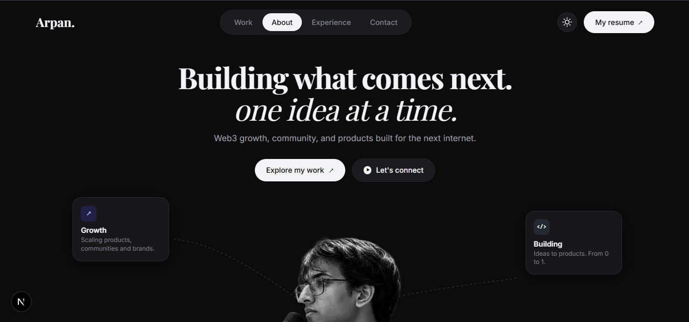

# Arpan Roy — Editorial Portfolio

A high-craft editorial portfolio website for Arpan Roy (Software Engineer & Builder), combining brutalist editorial typography, dark/light mode theming, archival artwork showcases, and smooth scroll animations.



---

## ✨ Features

- **Typography & Aesthetic**: Editorial design language combining Playfair Display (editorial serif), Inter (geometric sans), and Dancing Script (handwritten annotations).
- **Dual-Theme Engine**: Fully supported dark and light themes with smooth CSS variable transitions and `localStorage` persistence.
- **Interactive Staged Hero**: Landing showcase featuring a dynamic rotating SVG stamp badge, high-contrast portrait cutout, floating contextual cards with scroll parallax, and interactive action buttons.
- **Retro Workstation Terminal**: Custom vintage CRT PC setup with floppy disk drive, mechanical keyboard, and the iconic Blue Screen of Death terminal error.
- **Editorial Work & Timeline**: Selected projects grid and an interactive career experience timeline with dynamic scroll fill and glowing nodes.
- **Let's Connect Section**: Two-column outreach layout featuring an archival woodcut handshake etching.
- **Archival Footer**: Dedicated multi-column closing section showcasing fluid monochromatic ink topography (`footerart.jpg`), live availability badge, Kolkata local time/coordinates, and a smooth scroll-to-top button.
- **GPU Scroll Animations**: Custom IntersectionObserver-powered scroll reveals.
- **Dynamic Reading Progress**: Top viewport scroll indicator tracking reading depth in real-time.

---

## 🛠️ Tech Stack

- **Framework**: [Next.js 16](https://nextjs.org/) (App Router)
- **Library**: [React 19](https://react.dev/)
- **Bundler**: [Turbopack](https://turbo.build/pack)
- **Styling**: [Tailwind CSS v4](https://tailwindcss.com/)
- **Language**: TypeScript

---

## 🚀 Getting Started

### Prerequisites

- Node.js 18+ installed on your machine.
- npm or pnpm.

### Installation & Local Development

1. Clone the repository:
   ```bash
   git clone https://github.com/arg0506/Arpanroy05.git
   cd Arpanroy05
   ```

2. Navigate to the Next.js app directory:
   ```bash
   cd my-app
   ```

3. Install dependencies:
   ```bash
   npm install
   ```

4. Start the development server:
   ```bash
   npm run dev
   ```

5. Open [http://localhost:3000](http://localhost:3000) in your browser.

---

## 📄 License

MIT License. Designed and engineered by [Arpan Roy](https://github.com/arg0506).
